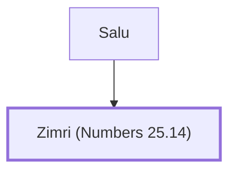

# Zimri (Numbers 25.14)

Simeonite prince, killed in the Baal-Peor incident

**Original-language names:** זִמְרִי (H2174a)

## When

- **Placed around:** [[connections/timeline/15th century BC|1452 BC]] *(Ussher: the median date of the passages naming them)*

## Family

- **Father:** [[connections/people/Salu|Salu]]

**Family group:** [[connections/genealogy/Family of Salu|Family of Salu]], generation 2

## Appears in

[[connections/chapters/04-numbers/Numbers 25|Numbers 25]]

## Appears in the same verse as

[[connections/people/Salu|Salu]] · [[connections/people/Simeon (Genesis 29.33)|Simeon (Genesis 29.33)]]
