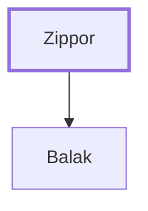

# Zippor

Father of Balak, king of Moab

**Original-language names:** צִפּוֹר (H6834)

## When

- **Placed around:** [[connections/timeline/15th century BC|1452 BC]] *(Ussher: the median date of the passages naming them)*

## Family

- **Children:** [[connections/people/Balak|Balak]]
- **Tribe or nation:** Moab

**Family group:** [[connections/genealogy/Family of Zippor|Family of Zippor]], generation 1

## Appears in

[[connections/chapters/04-numbers/Numbers 22|Numbers 22 (4)]] · [[connections/chapters/04-numbers/Numbers 23|Numbers 23]] · [[connections/chapters/06-joshua/Joshua 24|Joshua 24]] · [[connections/chapters/07-judges/Judges 11|Judges 11]]

## Appears in the same verse as

[[connections/people/Balak|Balak (7)]] · [[connections/places/Moab|Moab (4)]] · [[connections/people/Balaam|Balaam (3)]] · [[connections/people/Israel|Israel (3)]] · [[connections/people/Beor (Numbers 22.5)|Beor (Numbers 22.5)]] · [[connections/places/Midian|Midian]]
