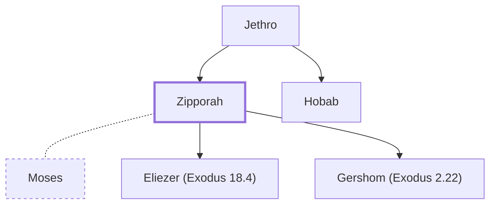

# Zipporah

Wife of Moses, daughter of Jethro

**Original-language names:** צִפֹּרָה (H6855)

## When

- **Placed around:** [[connections/timeline/15th century BC|1491 BC]] *(Ussher: the median date of the passages naming them)*

## Family

- **Father:** [[connections/people/Jethro|Jethro]]
- **Brothers and sisters:** [[connections/people/Hobab|Hobab]]
- **Spouses:** [[connections/people/Moses|Moses]]
- **Children:** [[connections/people/Eliezer (Exodus 18.4)|Eliezer (Exodus 18.4)]], [[connections/people/Gershom (Exodus 2.22)|Gershom (Exodus 2.22)]]
- **Tribe or nation:** Midian

**Family group:** [[connections/genealogy/Family of Adam|Family of Adam]], generation 2

## Appears in

[[connections/chapters/02-exodus/Exodus 2|Exodus 2]] · [[connections/chapters/02-exodus/Exodus 4|Exodus 4]] · [[connections/chapters/02-exodus/Exodus 18|Exodus 18]]

## Appears in the same verse as

[[connections/people/Moses|Moses (2)]] · [[connections/people/Jethro|Jethro]]
