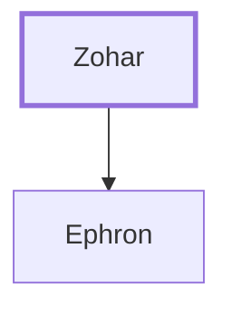

# Zohar

Father of Ephron the Hittite

**Original-language names:** צֹ֫חַר (H6714)

## When

- **Placed around:** [[connections/timeline/19th century BC|1821 BC]] *(Ussher: the median date of the passages naming them)*

## Family

- **Children:** [[connections/people/Ephron|Ephron]]

**Family group:** [[connections/genealogy/Family of Zohar|Family of Zohar]], generation 1

## Appears in

[[connections/chapters/01-genesis/Genesis 23|Genesis 23]] · [[connections/chapters/01-genesis/Genesis 25|Genesis 25]]

## Appears in the same verse as

[[connections/people/Ephron|Ephron (2)]] · [[connections/people/Isaac|Isaac]] · [[connections/people/Ishmael (Genesis 16.11)|Ishmael (Genesis 16.11)]] · [[connections/places/Machpelah|Machpelah]] · [[connections/places/Mamre|Mamre]]
