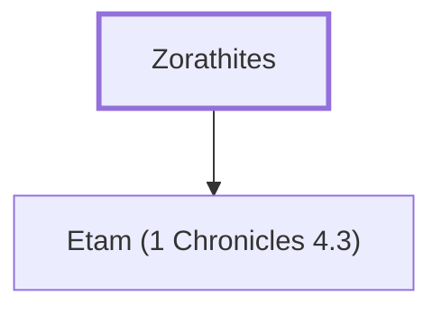

# Zorathites

Judahite clan descended from Shobal

**Original-language names:** צָּרְעִֽי (H6882)

## When

- **Placed around:** [[connections/timeline/15th century BC|1470 BC]] *(Ussher: the median date of the passages naming them)*

## Family

- **Children:** [[connections/places/Etam (1 Chronicles 4.3)|Etam (1 Chronicles 4.3) (founder)]]

**Family group:** [[connections/genealogy/Family of Zorathites|Family of Zorathites]], generation 1

## Appears in

[[connections/chapters/13-1-chronicles/1 Chronicles 2|1 Chronicles 2]]

## Appears in the same verse as

[[connections/people/Manahath|Manahath]] · [[connections/people/Salma|Salma]] · [[connections/places/Atroth-beth-joab|Atroth-beth-joab]] · [[connections/places/Bethlehem (Genesis 35.16)|Bethlehem (Genesis 35.16)]]
