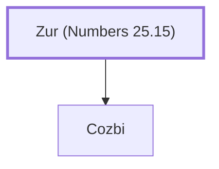

# Zur (Numbers 25.15)

Midianite leader killed by Phinehas

**Original-language names:** צוּר (H6698)

## When

- **Placed around:** [[connections/timeline/15th century BC|1452 BC]] *(Ussher: the median date of the passages naming them)*

## Family

- **Children:** [[connections/people/Cozbi|Cozbi]]

**Family group:** [[connections/genealogy/Family of Zur (Numbers 25.15)|Family of Zur (Numbers 25.15)]], generation 1

## Appears in

[[connections/chapters/04-numbers/Numbers 25|Numbers 25]]

## Appears in the same verse as

[[connections/people/Cozbi|Cozbi]] · [[connections/places/Midian|Midian]]
