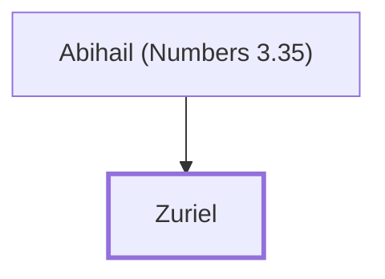

# Zuriel

Leader of the Merarite Levites

**Original-language names:** צוּרִיאֵל (H6700)

## When

- **Placed around:** [[connections/timeline/15th century BC|1490 BC]] *(Ussher: the median date of the passages naming them)*

## Family

- **Father:** [[connections/people/Abihail (Numbers 3.35)|Abihail (Numbers 3.35)]]

**Family group:** [[connections/genealogy/Family of Abihail (Numbers 3.35)|Family of Abihail (Numbers 3.35)]], generation 2

## Appears in

[[connections/chapters/04-numbers/Numbers 3|Numbers 3]]

## Appears in the same verse as

[[connections/people/Abihail (Numbers 3.35)|Abihail (Numbers 3.35)]]
