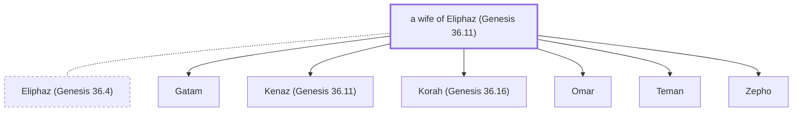

# a wife of Eliphaz (Genesis 36.11)

Wife of Eliphaz and mother of Teman.

*Not named in the text. Included because a family line passes through this person.*

**Original-language names:** . (H0464I)

## Family

- **Spouses:** [[connections/people/Eliphaz (Genesis 36.4)|Eliphaz (Genesis 36.4)]]
- **Children:** [[connections/people/Gatam|Gatam]], [[connections/people/Kenaz (Genesis 36.11)|Kenaz (Genesis 36.11)]], [[connections/people/Korah (Genesis 36.16)|Korah (Genesis 36.16)]], [[connections/people/Omar|Omar]], [[connections/people/Teman|Teman]], [[connections/people/Zepho|Zepho]]
- **Tribe or nation:** Edom

**Family group:** [[connections/genealogy/Family of Adam|Family of Adam]], generation 26

## Mentioned in

[[connections/chapters/01-genesis/Genesis 36|Genesis 36 (2)]] · [[connections/chapters/13-1-chronicles/1 Chronicles 1|1 Chronicles 1]]
