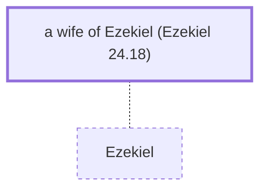

# a wife of Ezekiel (Ezekiel 24.18)

Wife of Ezekiel - Died as a sign to Israel

*Not named in the text. Included because a family line passes through this person.*

**Original-language names:** . (H3168I)

## Family

- **Spouses:** [[connections/people/Ezekiel|Ezekiel]]

## Mentioned in

[[connections/chapters/26-ezekiel/Ezekiel 24|Ezekiel 24]]
