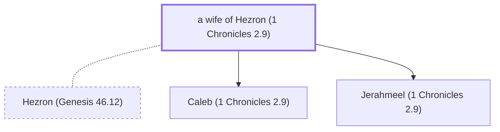

# a wife of Hezron (1 Chronicles 2.9)

Mother of Jerahmeel, Ram, and Caleb

*Not named in the text. Included because a family line passes through this person.*

**Original-language names:** . (H2696K)

## Family

- **Spouses:** [[connections/people/Hezron (Genesis 46.12)|Hezron (Genesis 46.12)]]
- **Children:** [[connections/people/Caleb (1 Chronicles 2.9)|Caleb (1 Chronicles 2.9) (uncertain)]], [[connections/people/Jerahmeel (1 Chronicles 2.9)|Jerahmeel (1 Chronicles 2.9) (uncertain)]]
- **Tribe or nation:** Tribe of Judah

**Family group:** [[connections/genealogy/Family of Adam|Family of Adam]], generation 28

## Mentioned in

[[connections/chapters/13-1-chronicles/1 Chronicles 2|1 Chronicles 2]]
