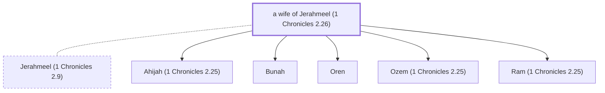

# a wife of Jerahmeel (1 Chronicles 2.26)

Wife of Jerahmeel; mother of Ram

*Not named in the text. Included because a family line passes through this person.*

**Original-language names:** . (H3396J)

## Family

- **Spouses:** [[connections/people/Jerahmeel (1 Chronicles 2.9)|Jerahmeel (1 Chronicles 2.9)]]
- **Children:** [[connections/people/Ahijah (1 Chronicles 2.25)|Ahijah (1 Chronicles 2.25)]], [[connections/people/Bunah|Bunah]], [[connections/people/Oren|Oren]], [[connections/people/Ozem (1 Chronicles 2.25)|Ozem (1 Chronicles 2.25)]], [[connections/people/Ram (1 Chronicles 2.25)|Ram (1 Chronicles 2.25)]]
- **Tribe or nation:** Tribe of Judah(?)

**Family group:** [[connections/genealogy/Family of Adam|Family of Adam]], generation 29

## Mentioned in

[[connections/chapters/13-1-chronicles/1 Chronicles 2|1 Chronicles 2]]
