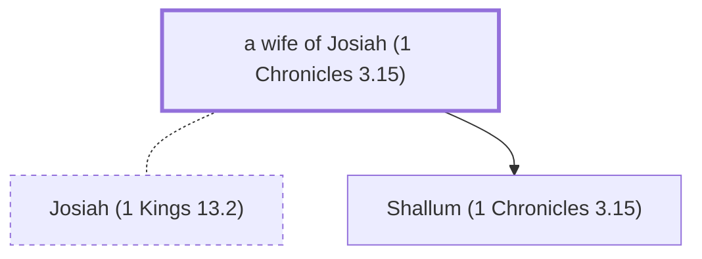

# a wife of Josiah (1 Chronicles 3.15)

A wife of Josiah; mother of Shallum

*Not named in the text. Included because a family line passes through this person.*

**Original-language names:** . (H2977I)

## Family

- **Spouses:** [[connections/people/Josiah (1 Kings 13.2)|Josiah (1 Kings 13.2)]]
- **Children:** [[connections/people/Shallum (1 Chronicles 3.15)|Shallum (1 Chronicles 3.15)]]
- **Tribe or nation:** Tribe of Judah

**Family group:** [[connections/genealogy/Family of Adam|Family of Adam]], generation 53

## Mentioned in

[[connections/chapters/13-1-chronicles/1 Chronicles 3|1 Chronicles 3]]
