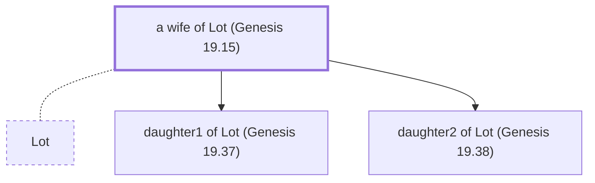

# a wife of Lot (Genesis 19.15)

Wife of Lot, daughter-in-law of Terah

*Not named in the text. Included because a family line passes through this person.*

**Original-language names:** . (H3876J)

## Family

- **Spouses:** [[connections/people/Lot|Lot]]
- **Children:** [[connections/people/daughter1 of Lot (Genesis 19.37)|daughter1 of Lot (Genesis 19.37)]], [[connections/people/daughter2 of Lot (Genesis 19.38)|daughter2 of Lot (Genesis 19.38)]]
- **Tribe or nation:** Early Patriarch

**Family group:** [[connections/genealogy/Family of Adam|Family of Adam]], generation 22

## Mentioned in

[[connections/chapters/01-genesis/Genesis 19|Genesis 19 (2)]]
