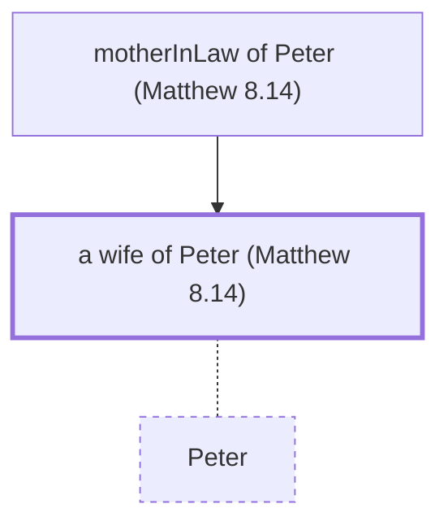

# a wife of Peter (Matthew 8.14)

Wife of Peter, whose mother Jesus healed

*Not named in the text. Included because a family line passes through this person.*

**Original-language names:** . (G4074H)

## Family

- **Mother:** [[connections/people/motherInLaw of Peter (Matthew 8.14)|motherInLaw of Peter (Matthew 8.14)]]
- **Spouses:** [[connections/people/Peter|Peter]]

**Family group:** [[connections/genealogy/Family of motherInLaw of Peter (Matthew 8.14)|Family of motherInLaw of Peter (Matthew 8.14)]], generation 2

## Mentioned in

[[connections/chapters/40-matthew/Matthew 8|Matthew 8]] · [[connections/chapters/46-1-corinthians/1 Corinthians 9|1 Corinthians 9]]
