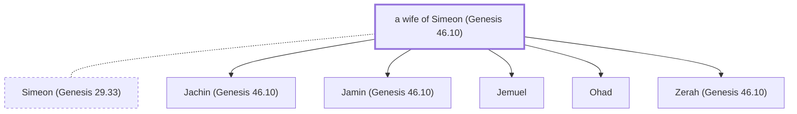

# a wife of Simeon (Genesis 46.10)

Wife of Simeon, the son of Jacob.

*Not named in the text. Included because a family line passes through this person.*

**Original-language names:** . (H8095I)

## Family

- **Spouses:** [[connections/people/Simeon (Genesis 29.33)|Simeon (Genesis 29.33)]]
- **Children:** [[connections/people/Jachin (Genesis 46.10)|Jachin (Genesis 46.10)]], [[connections/people/Jamin (Genesis 46.10)|Jamin (Genesis 46.10)]], [[connections/people/Jemuel|Jemuel]], [[connections/people/Ohad|Ohad]], [[connections/people/Zerah (Genesis 46.10)|Zerah (Genesis 46.10)]]
- **Tribe or nation:** Tribe of Simeon

**Family group:** [[connections/genealogy/Family of Adam|Family of Adam]], generation 26

## Mentioned in

[[connections/chapters/01-genesis/Genesis 46|Genesis 46]]
