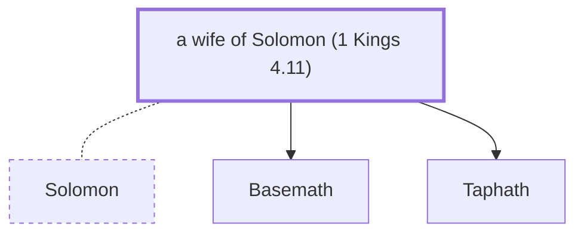

# a wife of Solomon (1 Kings 4.11)

Daughter of Abinadab, one of Solomon's wives.

*Not named in the text. Included because a family line passes through this person.*

**Original-language names:** . (H8010H)

## Family

- **Spouses:** [[connections/people/Solomon|Solomon]]
- **Children:** [[connections/people/Basemath|Basemath]], [[connections/people/Taphath|Taphath]]
- **Tribe or nation:** Tribe of Judah

**Family group:** [[connections/genealogy/Family of Adam|Family of Adam]], generation 37

## Mentioned in

[[connections/chapters/11-1-kings/1 Kings 4|1 Kings 4]]
