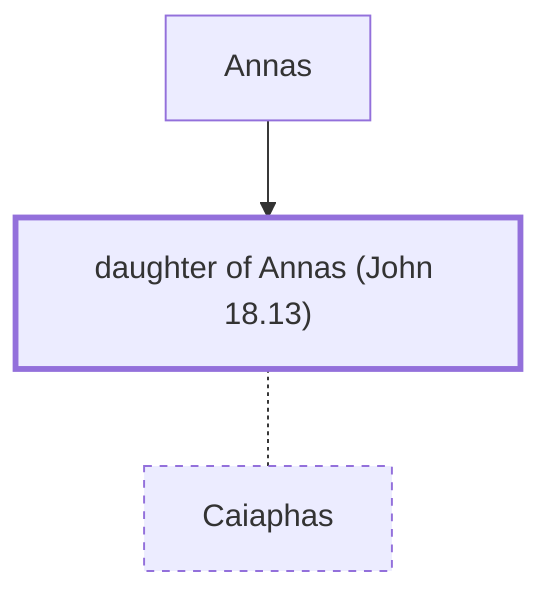

# daughter of Annas (John 18.13)

The wife of Caiaphas the high priest.

*Not named in the text. Included because a family line passes through this person.*

**Original-language names:** . (G2533H)

## Family

- **Father:** [[connections/people/Annas|Annas]]
- **Spouses:** [[connections/people/Caiaphas|Caiaphas]]

**Family group:** [[connections/genealogy/Family of Annas|Family of Annas]], generation 2

## Mentioned in

[[connections/chapters/43-john/John 18|John 18]]
