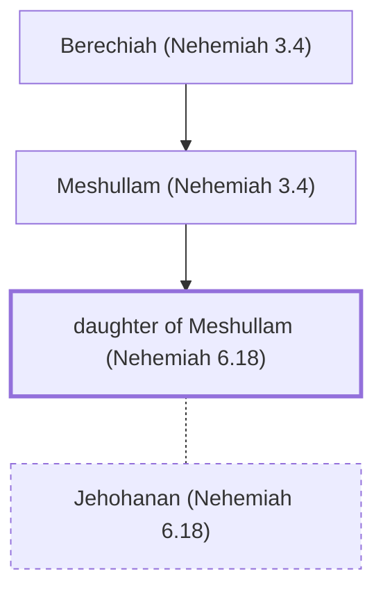

# daughter of Meshullam (Nehemiah 6.18)

Married Jehohanan, son of Tobiah the Ammonite

*Not named in the text. Included because a family line passes through this person.*

**Original-language names:** . (H4918z)

## Family

- **Father:** [[connections/people/Meshullam (Nehemiah 3.4)|Meshullam (Nehemiah 3.4)]]
- **Spouses:** [[connections/people/Jehohanan (Nehemiah 6.18)|Jehohanan (Nehemiah 6.18)]]

**Line of descent** (4 generations, father to son): [[connections/people/Meshezabel (Nehemiah 3.4)|Meshezabel (Nehemiah 3.4)]] → [[connections/people/Berechiah (Nehemiah 3.4)|Berechiah (Nehemiah 3.4)]] → [[connections/people/Meshullam (Nehemiah 3.4)|Meshullam (Nehemiah 3.4)]] → **daughter of Meshullam (Nehemiah 6.18)**

**Family group:** [[connections/genealogy/Family of Meshezabel (Nehemiah 3.4)|Family of Meshezabel (Nehemiah 3.4)]], generation 4

## Mentioned in

[[connections/chapters/16-nehemiah/Nehemiah 6|Nehemiah 6]]
