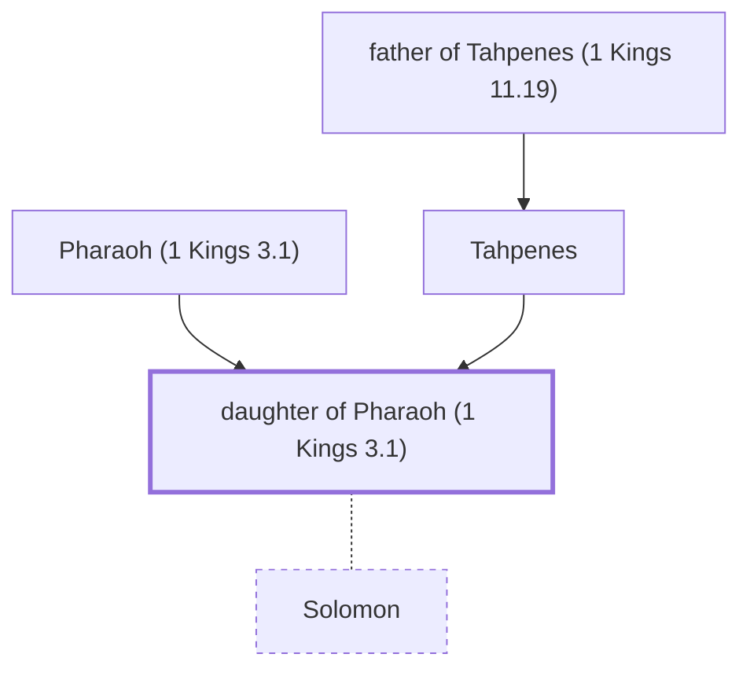

# daughter of Pharaoh (1 Kings 3.1)

Daughter of Pharaoh - Wife of King Solomon

*Not named in the text. Included because a family line passes through this person.*

**Original-language names:** . (H6547P)

## Family

- **Father:** [[connections/people/Pharaoh (1 Kings 3.1)|Pharaoh (1 Kings 3.1)]]
- **Mother:** [[connections/people/Tahpenes|Tahpenes]]
- **Spouses:** [[connections/people/Solomon|Solomon]]
- **Tribe or nation:** Egypt

**Family group:** [[connections/genealogy/Family of father of Tahpenes (1 Kings 11.19)|Family of father of Tahpenes (1 Kings 11.19)]], generation 3

## Mentioned in

[[connections/chapters/11-1-kings/1 Kings 3|1 Kings 3]]
