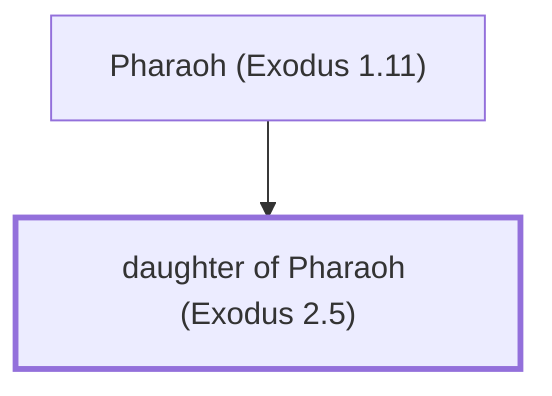

# daughter of Pharaoh (Exodus 2.5)

Daughter of Pharaoh - Rescued and adopted Moses

*Not named in the text. Included because a family line passes through this person.*

**Original-language names:** . (H6547O)

## Family

- **Father:** [[connections/people/Pharaoh (Exodus 1.11)|Pharaoh (Exodus 1.11)]]
- **Tribe or nation:** Egypt

**Family group:** [[connections/genealogy/Family of Pharaoh (Exodus 1.11)|Family of Pharaoh (Exodus 1.11)]], generation 2

## Mentioned in

[[connections/chapters/02-exodus/Exodus 2|Exodus 2]]
