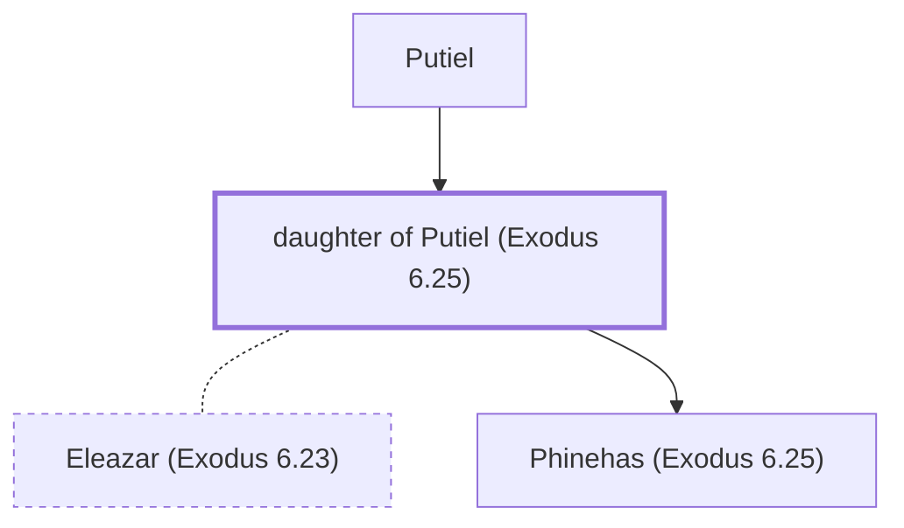

# daughter of Putiel (Exodus 6.25)

Daughter of Putiel - Wife of Eleazar the priest

*Not named in the text. Included because a family line passes through this person.*

**Original-language names:** . (H6317H)

## Family

- **Father:** [[connections/people/Putiel|Putiel]]
- **Spouses:** [[connections/people/Eleazar (Exodus 6.23)|Eleazar (Exodus 6.23)]]
- **Children:** [[connections/people/Phinehas (Exodus 6.25)|Phinehas (Exodus 6.25)]]

**Family group:** [[connections/genealogy/Family of Adam|Family of Adam]], generation 2

## Mentioned in

[[connections/chapters/02-exodus/Exodus 6|Exodus 6]]
