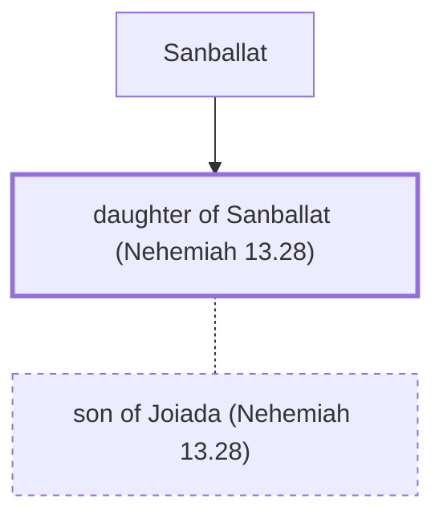

# daughter of Sanballat (Nehemiah 13.28)

Married to a grandson of the high priest Eliashib

*Not named in the text. Included because a family line passes through this person.*

**Original-language names:** . (H5571H)

## Family

- **Father:** [[connections/people/Sanballat|Sanballat]]
- **Spouses:** [[connections/people/son of Joiada (Nehemiah 13.28)|son of Joiada (Nehemiah 13.28)]]

**Family group:** [[connections/genealogy/Family of Sanballat|Family of Sanballat]], generation 2

## Mentioned in

[[connections/chapters/16-nehemiah/Nehemiah 13|Nehemiah 13]]
