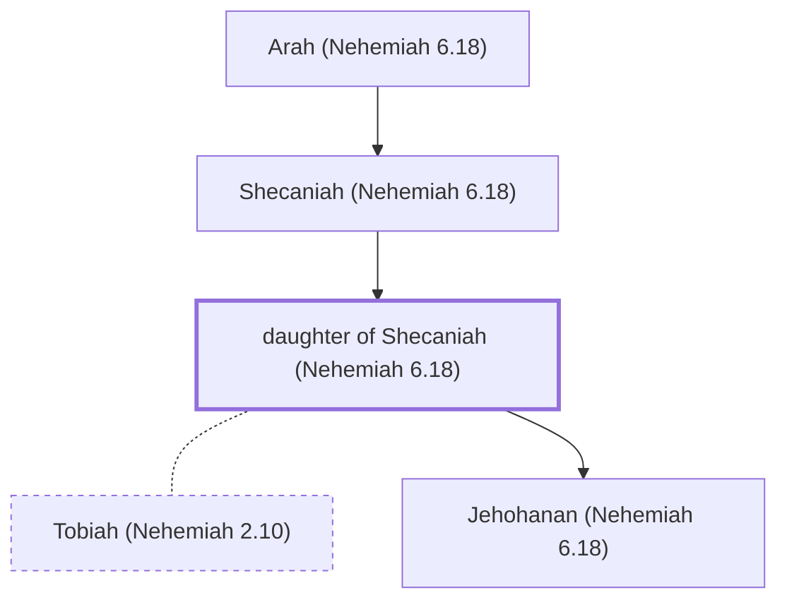

# daughter of Shecaniah (Nehemiah 6.18)

Married to one of Tobiah's sons

*Not named in the text. Included because a family line passes through this person.*

**Original-language names:** . (H7935N)

## Family

- **Father:** [[connections/people/Shecaniah (Nehemiah 6.18)|Shecaniah (Nehemiah 6.18)]]
- **Spouses:** [[connections/people/Tobiah (Nehemiah 2.10)|Tobiah (Nehemiah 2.10)]]
- **Children:** [[connections/people/Jehohanan (Nehemiah 6.18)|Jehohanan (Nehemiah 6.18)]]

**Line of descent** (3 generations, father to son): [[connections/people/Arah (Nehemiah 6.18)|Arah (Nehemiah 6.18)]] → [[connections/people/Shecaniah (Nehemiah 6.18)|Shecaniah (Nehemiah 6.18)]] → **daughter of Shecaniah (Nehemiah 6.18)**

**Family group:** [[connections/genealogy/Family of Arah (Nehemiah 6.18)|Family of Arah (Nehemiah 6.18)]], generation 3

## Mentioned in

[[connections/chapters/16-nehemiah/Nehemiah 6|Nehemiah 6]]
