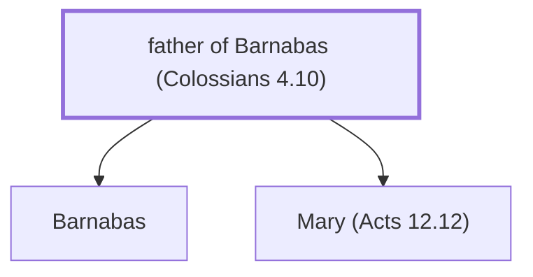

# father of Barnabas (Colossians 4.10)

A close relative of John Mark.

*Not named in the text. Included because a family line passes through this person.*

**Original-language names:** . (G0921H)

## Family

- **Children:** [[connections/people/Barnabas|Barnabas]], [[connections/people/Mary (Acts 12.12)|Mary (Acts 12.12)]]
- **Tribe or nation:** Tribe of Levi

**Family group:** [[connections/genealogy/Family of father of Barnabas (Colossians 4.10)|Family of father of Barnabas (Colossians 4.10)]], generation 1

## Mentioned in

[[connections/chapters/51-colossians/Colossians 4|Colossians 4]]
