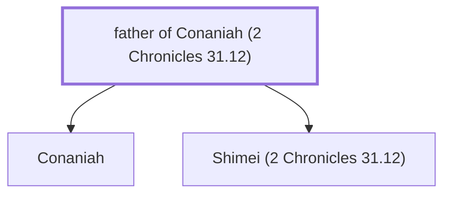

# father of Conaniah (2 Chronicles 31.12)

Father of Conaniah, a Levite in charge of offerings

*Not named in the text. Included because a family line passes through this person.*

**Original-language names:** . (H3562H)

## Family

- **Children:** [[connections/people/Conaniah|Conaniah]], [[connections/people/Shimei (2 Chronicles 31.12)|Shimei (2 Chronicles 31.12)]]

**Family group:** [[connections/genealogy/Family of father of Conaniah (2 Chronicles 31.12)|Family of father of Conaniah (2 Chronicles 31.12)]], generation 1

## Mentioned in

[[connections/chapters/14-2-chronicles/2 Chronicles 31|2 Chronicles 31]]
