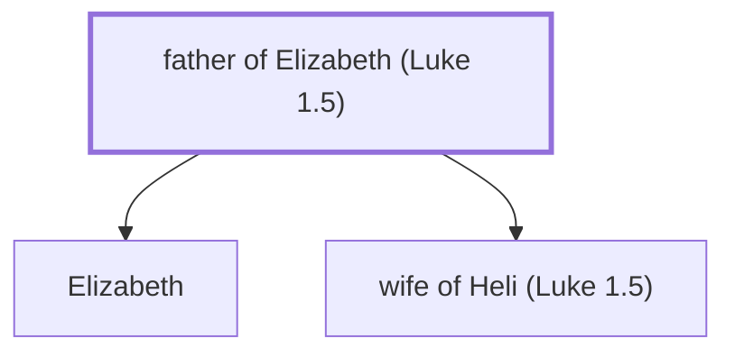

# father of Elizabeth (Luke 1.5)

The wife of Zechariah and mother of John the Baptist.

*Not named in the text. Included because a family line passes through this person.*

**Original-language names:** . (G1665H)

## Family

- **Children:** [[connections/people/Elizabeth|Elizabeth]], [[connections/people/wife of Heli (Luke 1.5)|wife of Heli (Luke 1.5)]]
- **Tribe or nation:** Tribe of Levi

**Family group:** [[connections/genealogy/Family of Adam|Family of Adam]], generation 1

## Mentioned in

[[connections/chapters/42-luke/Luke 1|Luke 1]]
