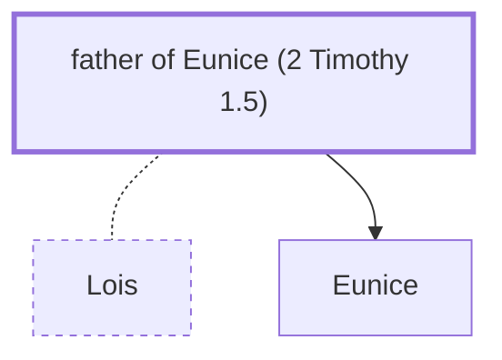

# father of Eunice (2 Timothy 1.5)

Father of Eunice - Grandfather of Timothy

*Not named in the text. Included because a family line passes through this person.*

**Original-language names:** . (G2131H)

## Family

- **Spouses:** [[connections/people/Lois|Lois]]
- **Children:** [[connections/people/Eunice|Eunice]]

**Family group:** [[connections/genealogy/Family of Lois|Family of Lois]], generation 1

## Mentioned in

[[connections/chapters/55-2-timothy/2 Timothy 1|2 Timothy 1]]
