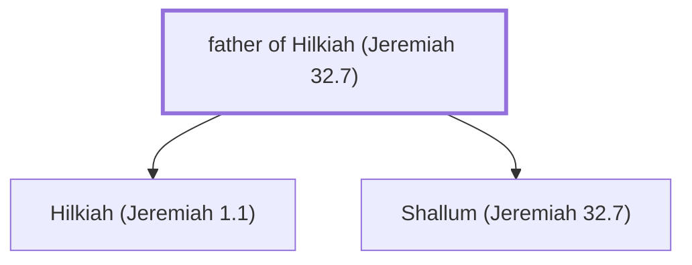

# father of Hilkiah (Jeremiah 32.7)

Father of Hilkiah, Jeremiah's cousin

*Not named in the text. Included because a family line passes through this person.*

**Original-language names:** . (H2518N)

## Family

- **Children:** [[connections/people/Hilkiah (Jeremiah 1.1)|Hilkiah (Jeremiah 1.1)]], [[connections/people/Shallum (Jeremiah 32.7)|Shallum (Jeremiah 32.7)]]

**Family group:** [[connections/genealogy/Family of father of Hilkiah (Jeremiah 32.7)|Family of father of Hilkiah (Jeremiah 32.7)]], generation 1

## Mentioned in

[[connections/chapters/24-jeremiah/Jeremiah 32|Jeremiah 32]]
