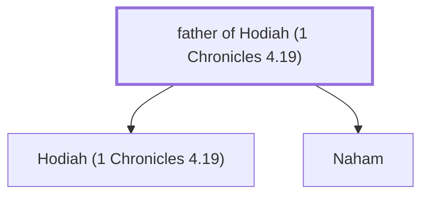

# father of Hodiah (1 Chronicles 4.19)

Father of Hodiah and Naham

*Not named in the text. Included because a family line passes through this person.*

**Original-language names:** . (H1940H)

## Family

- **Children:** [[connections/people/Hodiah (1 Chronicles 4.19)|Hodiah (1 Chronicles 4.19)]], [[connections/people/Naham|Naham]]
- **Tribe or nation:** Tribe of Judah(?)

**Family group:** [[connections/genealogy/Family of father of Hodiah (1 Chronicles 4.19)|Family of father of Hodiah (1 Chronicles 4.19)]], generation 1

## Mentioned in

[[connections/chapters/13-1-chronicles/1 Chronicles 4|1 Chronicles 4]]
