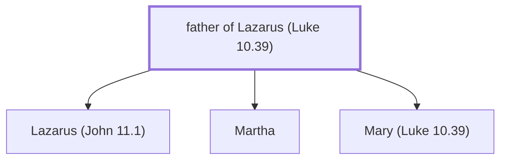

# father of Lazarus (Luke 10.39)

The father of Mary, Martha and Lazarus of Bethany.

*Not named in the text. Included because a family line passes through this person.*

**Original-language names:** . (G2976I)

## Family

- **Children:** [[connections/people/Lazarus (John 11.1)|Lazarus (John 11.1)]], [[connections/people/Martha|Martha]], [[connections/people/Mary (Luke 10.39)|Mary (Luke 10.39)]]

**Family group:** [[connections/genealogy/Family of father of Lazarus (Luke 10.39)|Family of father of Lazarus (Luke 10.39)]], generation 1

## Mentioned in

[[connections/chapters/42-luke/Luke 10|Luke 10]]
