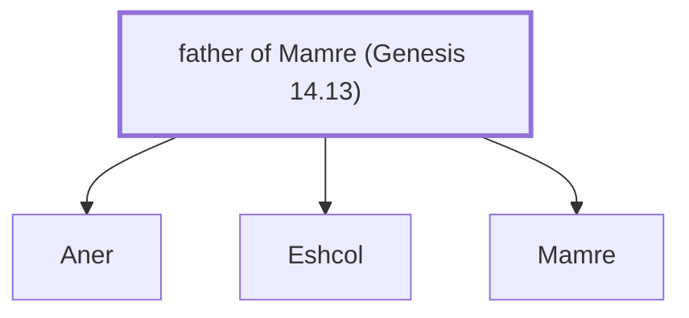

# father of Mamre (Genesis 14.13)

Father of Mamre - Amorite, ally of Abraham

*Not named in the text. Included because a family line passes through this person.*

**Original-language names:** . (H4471I)

## Family

- **Children:** [[connections/people/Aner|Aner]], [[connections/people/Eshcol|Eshcol]], [[connections/people/Mamre|Mamre]]

**Family group:** [[connections/genealogy/Family of father of Mamre (Genesis 14.13)|Family of father of Mamre (Genesis 14.13)]], generation 1

## Mentioned in

[[connections/chapters/01-genesis/Genesis 14|Genesis 14]]
