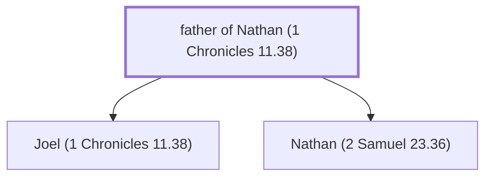

# father of Nathan (1 Chronicles 11.38)

Father of Nathan, one of David's mighty men

*Not named in the text. Included because a family line passes through this person.*

**Original-language names:** . (H5416M)

## Family

- **Children:** [[connections/people/Joel (1 Chronicles 11.38)|Joel (1 Chronicles 11.38)]], [[connections/people/Nathan (2 Samuel 23.36)|Nathan (2 Samuel 23.36)]]

**Family group:** [[connections/genealogy/Family of father of Nathan (1 Chronicles 11.38)|Family of father of Nathan (1 Chronicles 11.38)]], generation 1

## Mentioned in

[[connections/chapters/13-1-chronicles/1 Chronicles 11|1 Chronicles 11]]
