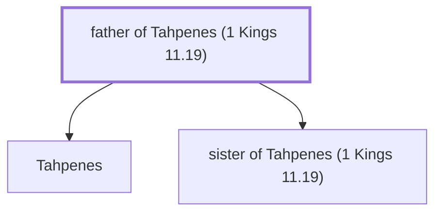

# father of Tahpenes (1 Kings 11.19)

Egyptian Pharaoh who gave his daughter to Hadad

*Not named in the text. Included because a family line passes through this person.*

**Original-language names:** . (H8472H)

## Family

- **Children:** [[connections/people/Tahpenes|Tahpenes]], [[connections/people/sister of Tahpenes (1 Kings 11.19)|sister of Tahpenes (1 Kings 11.19)]]

**Family group:** [[connections/genealogy/Family of father of Tahpenes (1 Kings 11.19)|Family of father of Tahpenes (1 Kings 11.19)]], generation 1

## Mentioned in

[[connections/chapters/11-1-kings/1 Kings 11|1 Kings 11]]
