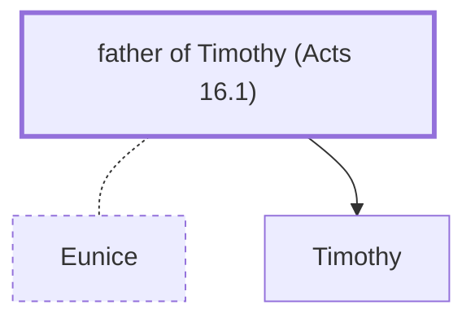

# father of Timothy (Acts 16.1)

Father of Timothy - Greek man; husband of Eunice

*Not named in the text. Included because a family line passes through this person.*

**Original-language names:** . (G5095H)

## Family

- **Spouses:** [[connections/people/Eunice|Eunice]]
- **Children:** [[connections/people/Timothy|Timothy]]

**Family group:** [[connections/genealogy/Family of Lois|Family of Lois]], generation 2

## Mentioned in

[[connections/chapters/44-acts/Acts 16|Acts 16]]
