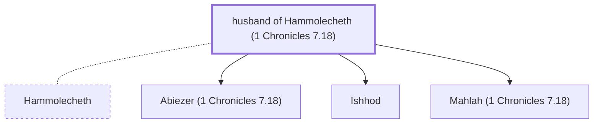

# husband of Hammolecheth (1 Chronicles 7.18)

Husband of Hammolecheth - Father of Ishhod, Abiezer, and Mahlah

*Not named in the text. Included because a family line passes through this person.*

**Original-language names:** . (H4447H)

## Family

- **Spouses:** [[connections/people/Hammolecheth|Hammolecheth]]
- **Children:** [[connections/people/Abiezer (1 Chronicles 7.18)|Abiezer (1 Chronicles 7.18)]], [[connections/people/Ishhod|Ishhod]], [[connections/people/Mahlah (1 Chronicles 7.18)|Mahlah (1 Chronicles 7.18)]]
- **Tribe or nation:** Tribe of Manasseh

**Family group:** [[connections/genealogy/Family of Adam|Family of Adam]], generation 29

## Mentioned in

[[connections/chapters/13-1-chronicles/1 Chronicles 7|1 Chronicles 7]]
