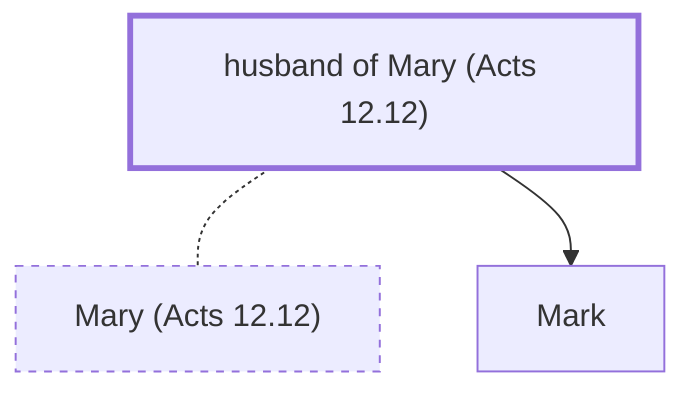

# husband of Mary (Acts 12.12)

Husband of Mary - John Mark's father

*Not named in the text. Included because a family line passes through this person.*

**Original-language names:** . (G3137N)

## Family

- **Spouses:** [[connections/people/Mary (Acts 12.12)|Mary (Acts 12.12)]]
- **Children:** [[connections/people/Mark|Mark]]
- **Tribe or nation:** Tribe of Levi

**Family group:** [[connections/genealogy/Family of father of Barnabas (Colossians 4.10)|Family of father of Barnabas (Colossians 4.10)]], generation 2

## Mentioned in

[[connections/chapters/44-acts/Acts 12|Acts 12]]
