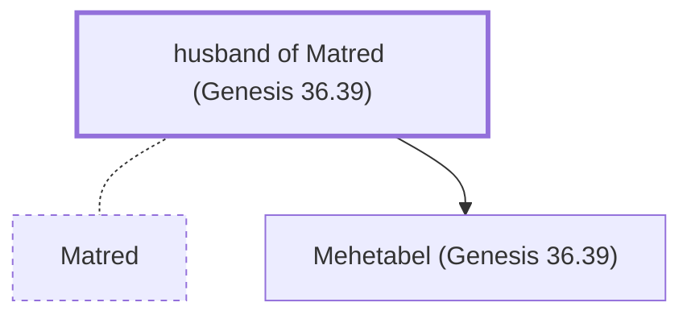

# husband of Matred (Genesis 36.39)

Husband of Matred, of Edomite royalty

*Not named in the text. Included because a family line passes through this person.*

**Original-language names:** . (H4308H)

## Family

- **Spouses:** [[connections/people/Matred|Matred]]
- **Children:** [[connections/people/Mehetabel (Genesis 36.39)|Mehetabel (Genesis 36.39)]]
- **Tribe or nation:** Edom

**Family group:** [[connections/genealogy/Family of Mezahab|Family of Mezahab]], generation 2

## Mentioned in

[[connections/chapters/01-genesis/Genesis 36|Genesis 36]]
