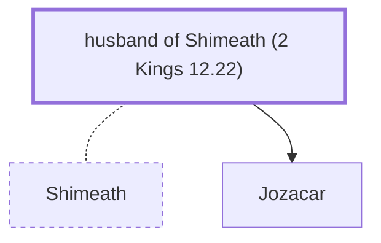

# husband of Shimeath (2 Kings 12.22)

Husband of Shimeath - Father of King Joash's assassins

*Not named in the text. Included because a family line passes through this person.*

**Original-language names:** . (H8100H)

## Family

- **Spouses:** [[connections/people/Shimeath|Shimeath]]
- **Children:** [[connections/people/Jozacar|Jozacar]]

**Family group:** [[connections/genealogy/Family of Shimeath|Family of Shimeath]], generation 1

## Mentioned in

[[connections/chapters/12-2-kings/2 Kings 12|2 Kings 12]]
