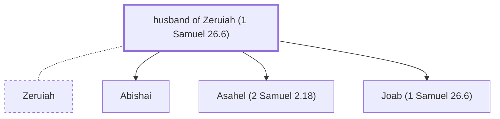

# husband of Zeruiah (1 Samuel 26.6)

Husband of Zeruiah; father of Abishai and Joab

*Not named in the text. Included because a family line passes through this person.*

**Original-language names:** . (H6870H)

## Family

- **Spouses:** [[connections/people/Zeruiah|Zeruiah]]
- **Children:** [[connections/people/Abishai|Abishai]], [[connections/people/Asahel (2 Samuel 2.18)|Asahel (2 Samuel 2.18)]], [[connections/people/Joab (1 Samuel 26.6)|Joab (1 Samuel 26.6)]]

**Family group:** [[connections/genealogy/Family of Adam|Family of Adam]], generation 36

## Mentioned in

[[connections/chapters/09-1-samuel/1 Samuel 26|1 Samuel 26]]
