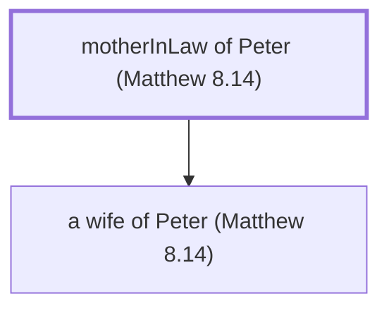

# motherInLaw of Peter (Matthew 8.14)

Mother-in-law of Peter, healed by Jesus

*Not named in the text. Included because a family line passes through this person.*

**Original-language names:** . (G4074I)

## Family

- **Children:** [[connections/people/a wife of Peter (Matthew 8.14)|a wife of Peter (Matthew 8.14)]]

**Family group:** [[connections/genealogy/Family of motherInLaw of Peter (Matthew 8.14)|Family of motherInLaw of Peter (Matthew 8.14)]], generation 1

## Mentioned in

[[connections/chapters/40-matthew/Matthew 8|Matthew 8]] · [[connections/chapters/41-mark/Mark 1|Mark 1]] · [[connections/chapters/42-luke/Luke 4|Luke 4]]
