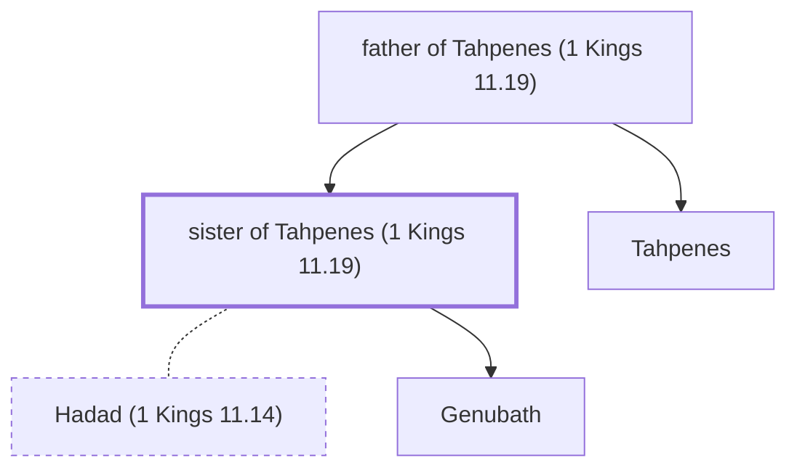

# sister of Tahpenes (1 Kings 11.19)

Egyptian queen, given in marriage to Hadad

*Not named in the text. Included because a family line passes through this person.*

**Original-language names:** . (H8472I)

## Family

- **Father:** [[connections/people/father of Tahpenes (1 Kings 11.19)|father of Tahpenes (1 Kings 11.19)]]
- **Brothers and sisters:** [[connections/people/Tahpenes|Tahpenes]]
- **Spouses:** [[connections/people/Hadad (1 Kings 11.14)|Hadad (1 Kings 11.14)]]
- **Children:** [[connections/people/Genubath|Genubath]]

**Family group:** [[connections/genealogy/Family of father of Tahpenes (1 Kings 11.19)|Family of father of Tahpenes (1 Kings 11.19)]], generation 2

## Mentioned in

[[connections/chapters/11-1-kings/1 Kings 11|1 Kings 11]]
