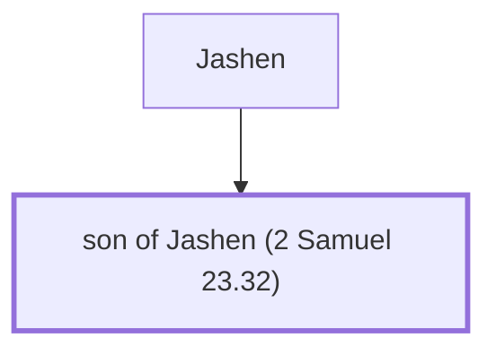

# son of Jashen (2 Samuel 23.32)

Son of Jashen - One of David's mighty men

*Not named in the text. Included because a family line passes through this person.*

**Original-language names:** . (H3464H)

## Family

- **Father:** [[connections/people/Jashen|Jashen]]

**Family group:** [[connections/genealogy/Family of Jashen|Family of Jashen]], generation 2

## Mentioned in

[[connections/chapters/10-2-samuel/2 Samuel 23|2 Samuel 23]]
