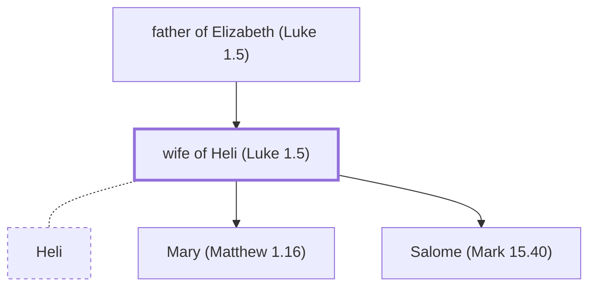

# wife of Heli (Luke 1.5)

The unnamed grandmother of Jesus.

*Not named in the text. Included because a family line passes through this person.*

**Original-language names:** . (G2242H)

## Family

- **Father:** [[connections/people/father of Elizabeth (Luke 1.5)|father of Elizabeth (Luke 1.5)]]
- **Spouses:** [[connections/people/Heli|Heli]]
- **Children:** [[connections/people/Mary (Matthew 1.16)|Mary (Matthew 1.16)]], [[connections/people/Salome (Mark 15.40)|Salome (Mark 15.40) (uncertain)]]
- **Tribe or nation:** Tribe of Levi(?)

**Family group:** [[connections/genealogy/Family of Adam|Family of Adam]], generation 2

## Mentioned in

[[connections/chapters/42-luke/Luke 1|Luke 1]]
